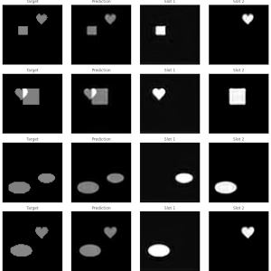

# two-sprite-compositional-learning
## Overview

This project investigates how different data sampling strategies influence compositional generalisation and learned representations in neural networks.

Using the **dSprites dataset**, we construct scenes containing two sprites and study how the distribution of training samples affects a model's ability to generalise to unseen combinations of object attributes.

## Research Question

**How does the sampling strategy used to construct a two-sprite training dataset influence compositional generalisation and the structure of learned representations?**

## Research Objectives

The project has two main objectives:

**1. Compositional Generalisation**
- Evaluate performance on in-distribution (ID) samples.
- Test generalisation to held-out combinations (OOD).
- Evaluate generalisation to continuously sampled latent configurations.

**2. Representation Analysis**
- Measure factorisation and orthogonality of learned representations.
- Evaluate attribute information using linear probes.
- Investigate cross-slot information leakage between the two sprites.

## Methodology

We compare different training data sampling strategies:

- Independent uniform sampling (baseline).
- Balanced sampling.
- Correlated sampling.
- Anti-correlated sampling.
- Structured or block sampling.

To ensure fair comparisons, we keep the model architecture, loss function, optimizer, training schedule, and evaluation datasets fixed. Experiments are repeated across multiple random seeds.

## Model

The initial model consists of two independent neural network branches, each generating a sprite image from its latent attributes. The generated images are combined using an occlusion-based composition function to produce the final scene.

## Repository Structure

```text
two-sprite-compositional-learning/
├── main.py
├── src/
│   ├── train.py
│   ├── model.py
│   ├── data.py
│   └── utils.py
├── cfgs/
├── experiments/
├── requirements.txt
└── README.md
```


## Data

### Dataset paths

The dataset path is configured in `main.py`. Update this path to match your local setup before running any experiments.

### Datasets

- **dSprites**: Download the dataset [here](YOUR_DATASET_DOWNLOAD_LINK).

After downloading, place the dataset in a local directory and update the dataset root path in `main.py`.

For example:

```python
"data": {"root": "/path/to/your/dsprites"}
```

The dataset is not included in this GitHub repository and must be downloaded separately.


## Installation and Usage

Install dependencies:

```bash
pip install -r requirements.txt
```

Run the default experiment:

```bash
python main.py
```

Run an experiment with a custom configuration:

```bash
python main.py --config cfgs/baseline.yml
```

## Goal

The goal is to understand how training data distributions shape learned representations and influence a neural network's ability to generalise compositionally to unseen configurations.





## References

- [Necessary Compositionality](https://arxiv.org/pdf/2602.24264)
- [Necessary Compositionality — Code](https://github.com/oshapio/necessary-compositionality/tree/main/src/complinearity)
- [Compositional OOD Generalization](https://github.com/brendel-group/compositional-ood-generalization)
